# Steampunk Foundry

[English](README.md) | [繁體中文](README.zh-TW.md) | [简体中文](README.zh-CN.md) | **日本語**

Obsidian 用のスチームパンクテーマです。真鍮・銅・緑青の配色、線路のようなインデント線、機械仕掛けの歯車、計器プレート風のコールアウト、そしてタブバーを流れる昼夜の空を備えています。すべての効果は**初期状態でオフ**なので、必要なものだけをオンにして使えます。

昼夜の空のプレビュー：
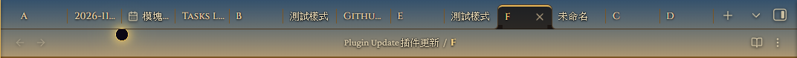
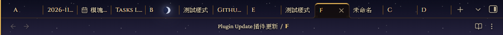
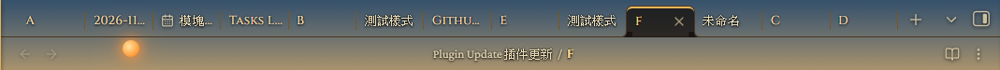
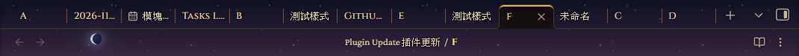
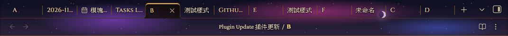
全体のプレビュー：
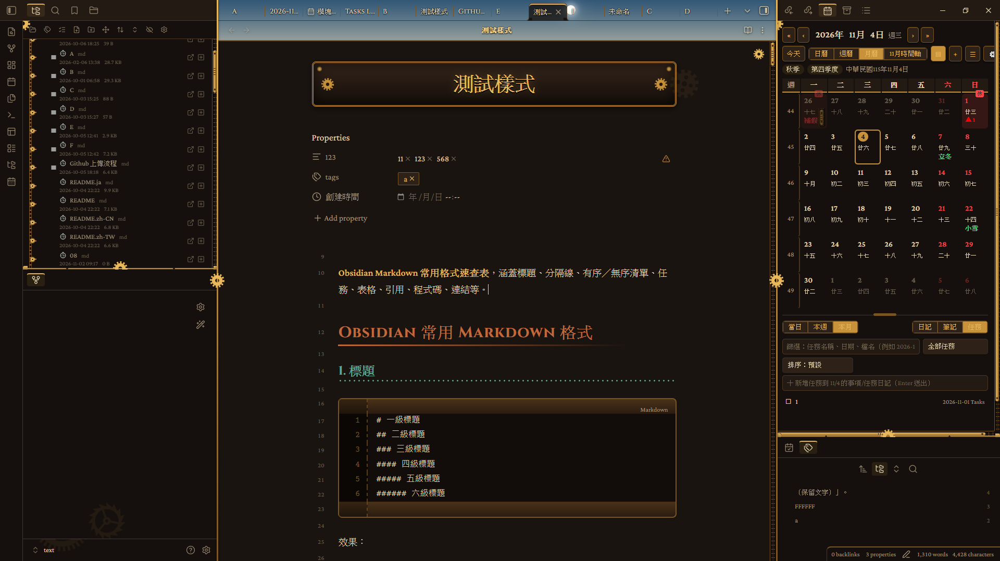
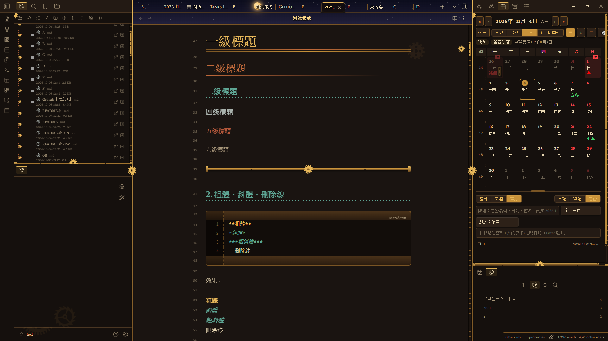
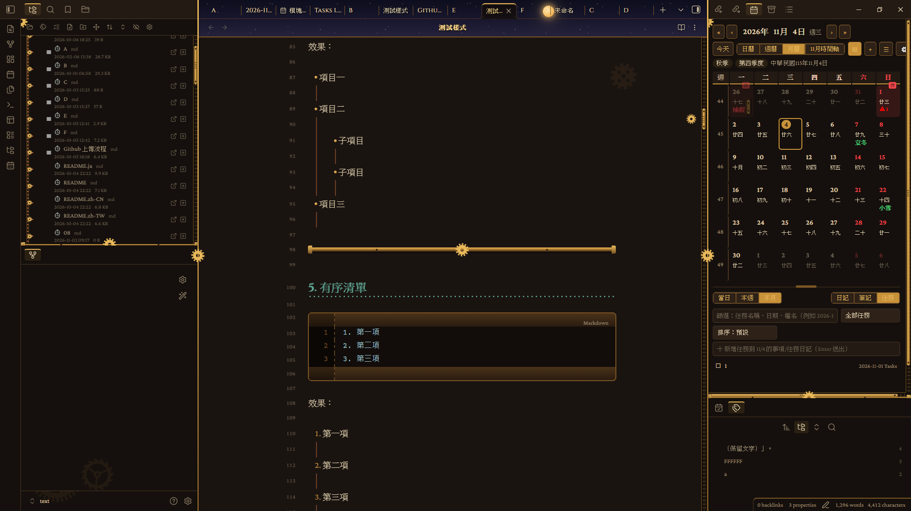
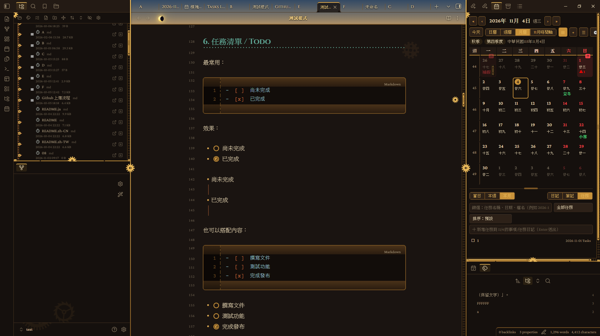
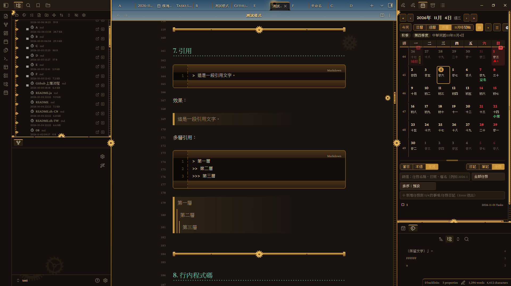
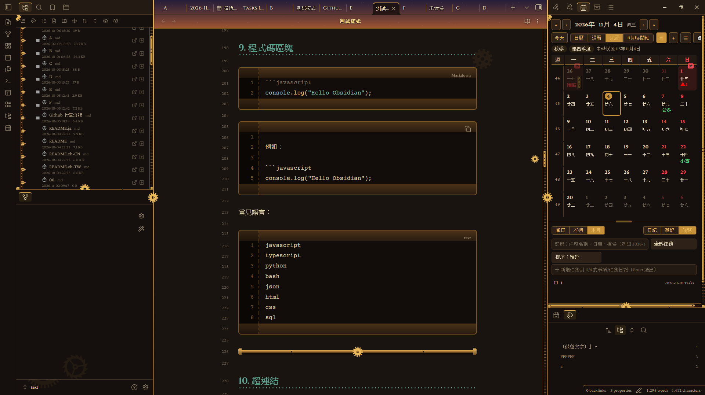
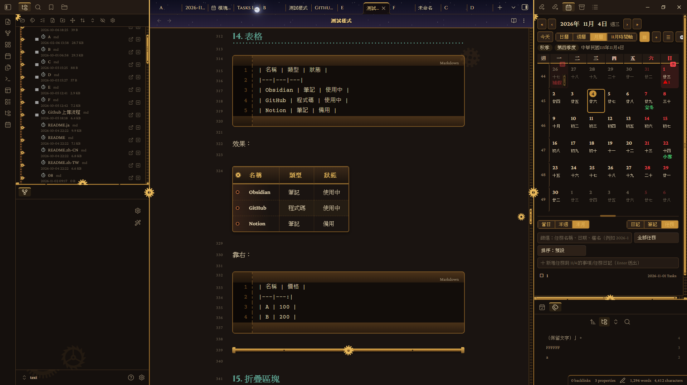
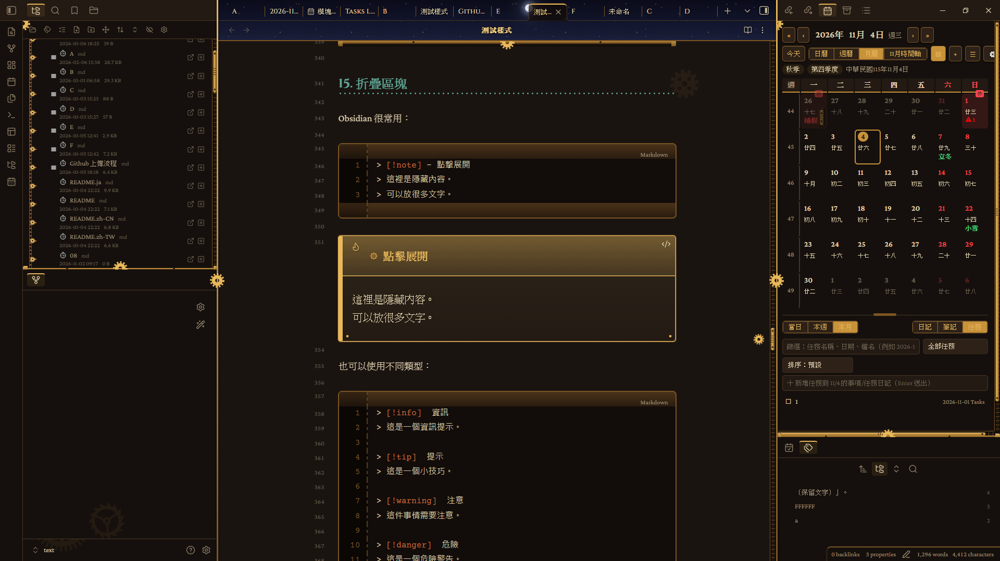
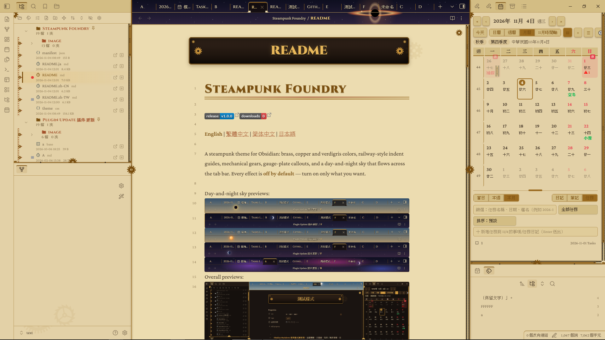

## 更新履歴

### 1.0.0

初回リリース：ダーク／ライトの配色、ファイルエクスプローラーとエディターの外観、機械的な装飾、昼夜の空、パフォーマンスプリセット、Style Settings のオプション。

## 機能

### 配色とフォント
- ダークの「ボイラー室」とライトの「羊皮紙の設計図」の2種類の配色。
- 明るい真鍮（H1・強調・太字）、真鍮（枠線・表の見出し・ボタン）、銅（H2・フォルダ名）、緑青（H3・リンク）の色を変更できます。
- 見出し・本文・コードのフォントを変更できます（フォント一覧をカンマ区切りで入力）。

### エディターとコンテンツ
- 見出しの階層、リストとインデント線、引用、区切り線。
- **コールアウト → 計器プレート**。
- **テーブル → パンチテープの帳簿**。
- **コードブロック → コントロールパネル**：上部のインジケーターランプと左側の行番号欄。
- **タスクリスト → 機械式文字盤のチェックボックス**。
- タブ、サイドバーの枠、スクロールバー。
- スマートフォン／タブレット向けのレイアウト調整。

### ファイルエクスプローラー
- インデント線が**線路のチェーン**に：二本のレールと枕木、各項目に小さな歯車が付き、ホバーすると回転します。
- 展開記号が**歯車の矢印**に。展開すると 90° 回転して光ります。
- フォルダアイコンは**リベット留めの銅の箱**に。ファイルアイコンは種類ごとに異なり、ノートは**機械式の文字盤**、canvas はコンパス、pdf／base はパンチカード、画像はレンズ、**HTML は山括弧、音楽は音符、動画は映写枠、コードは波括弧、アーカイブは木箱、テキストや Office 文書は紙、表計算は罫線**です。

### 機械と質感
- **背景の歯車群**：エディター右上に大小のかみ合う歯車、両サイドバーの下部にもそれぞれ歯車。濃さを調整できます。
- **スクロール連動の歯車**：スクロールやスクロールバーのドラッグ中、歯車が右側のレールに沿って移動しながら回転します。
- **ファイル名プレート**：エディター内の大きなタイトルが真鍮のネームプレートに（「設定 → エディター → 外観」で「インラインタイトルを表示」をオンにしてください）。
- **羊皮紙**風の背景、**蒸気のもや**（濃さを調整可）、**リベット付きの枠**、**金属の輝き**。
- **真鍮のボタン／タグ／検索ボックス**。リンクと選択色は Obsidian の変数を使うため、ライト・ダークの両方で使えます。

### 昼夜の空
- タブバー（パンくずバーまで広げることもできます）に昼夜のサイクルを表示し、太陽・月・星が時間とともに動きます。
- 昼は通常・淡い・琥珀色・血のように赤い太陽、部分日食と皆既日食。
- 夜は月相とスーパームーン、3種類の星雲の夜、緑と紫のオーロラ、流星群、彗星、部分月食と血月、さらに太陽系・銀河系・ブラックホール・星団の4つの奇観。
- 番組表はテーマに内蔵された 72 日分の事前計算済みで、プラグインは不要です。
- 昼夜サイクル1日の長さと、空を暗くする度合い（タブの文字が読みにくいときは上げてください）を調整できます。

### 動きとパフォーマンス
- **背景の動き**がマスタースイッチです。オフのとき、歯車・蒸気・金属の輝き・空はすべて静止します。
- **パフォーマンスプリセット**：高画質（すべてオン）、バランス（天体 30fps、蒸気・金属の輝き・スクロール連動の歯車をオフ）、省電力（さらにウィンドウ全体の粒子をオフ、天体は 10fps）。
- 天体（太陽／月）のフレームレートは 60／30／15／10／5 fps から選べます。流星・稲妻・奇観の更新頻度は高／中／低から選べます。

### 言語
- Style Settings のオプション名は、Obsidian の言語に自動で合わせて English／繁体字中国語／簡体字中国語／日本語で表示されます。それ以外の言語のときは English になります。
- 言語を変えるには、Obsidian の「設定 → 一般 → 言語」で変更してください（テーマ単体では切り替えられません）。

### コンテンツ幅
- 初期状態では Obsidian 本来のコンテンツ幅を使います。
- 「カスタムのコンテンツ幅」をオンにしたときだけ、設定した幅が適用されます。

## 使い方

### はじめに
1. **Style Settings** プラグインをインストールします（推奨。すべてのオプションはここにあります）。
2. 設定 → 外観 → テーマ で **Steampunk Foundry** を選びます。
3. Style Settings →「Steampunk Foundry」を開き、使いたい効果をオンにします。

### 昼夜の空を表示するには
1. 「背景の動き」をオンにします。
2. 「タブバーとパンくずバーの昼夜の空」をオンにします。
3. 空をパンくずバーまで広げたいときは、「空をパンくずバーまで広げる」もオンにします。

### 重いとき、タブの文字が読みにくいとき
- 大きなノートや低スペックのパソコン：「パフォーマンスプリセット」を「バランス」または「省電力」にします。
- タブの文字が空に隠れる：「空の暗さ」を上げます。

### オプションの表示言語が違うとき
- Style Settings は Obsidian 自体の言語（設定 → 一般 → 言語）に合わせます。対応外の言語では English になります。

### 他のアイコン系プラグインを使うとき
- アイコンが重複しないよう、「フォルダとファイルのアイコン」はオフのままにしてください。

## インストール

**手動：** 最新の [release](../../releases) から `theme.css` と `manifest.json` をダウンロードし、`<ボルト>/.obsidian/themes/Steampunk Foundry/` に置いて、「設定 → 外観」でテーマを選びます。**Style Settings** プラグインも併せてインストールすることをおすすめします。

## 注意事項

- **ネットワークリクエストなし、テレメトリなし、無料です。**
- 昼夜の空と動く背景は常に描画されます。大きなノートや低スペックのパソコンでは、パフォーマンスプリセットを「バランス」または「省電力」にしてください。
- ファイル名プレートには、「設定 → エディター → 外観」の「インラインタイトルを表示」が必要です。
- モバイル版はまだ実験的です。

## 問題の報告と提案

問題が起きたときやご提案があるときは、GitHub の[Issues](https://github.com/your-name/steampunk-foundry/issues)にお寄せください。Obsidian のバージョン、テーマの設定、再現手順（またはスクリーンショット）を添えていただけると、対応しやすくなります。
