# Steampunk Foundry

**English** | [繁體中文](README.zh-TW.md) | [简体中文](README.zh-CN.md) | [日本語](README.ja.md)

A steampunk theme for Obsidian: brass, copper and verdigris colors, railway-style indent guides, mechanical gears, gauge-plate callouts, and a day-and-night sky that flows across the tab bar. Every effect is **off by default** — turn on only what you want.

Day-and-night sky previews:
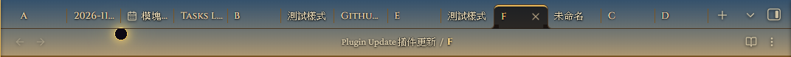
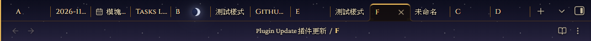
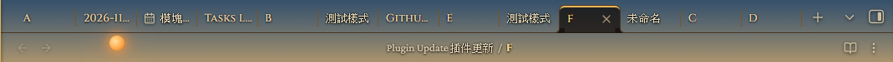
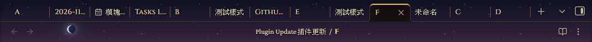
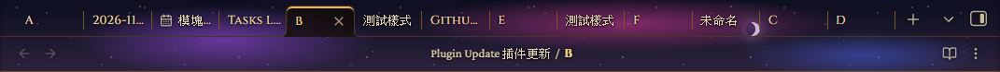
Overall previews:
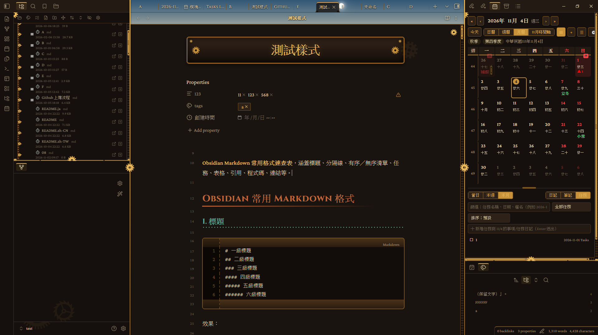
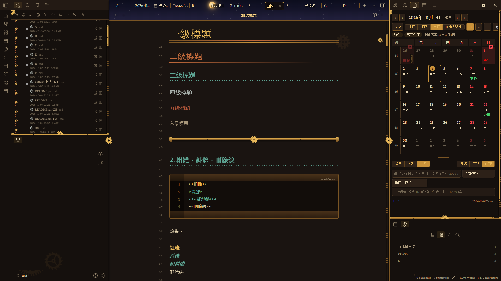
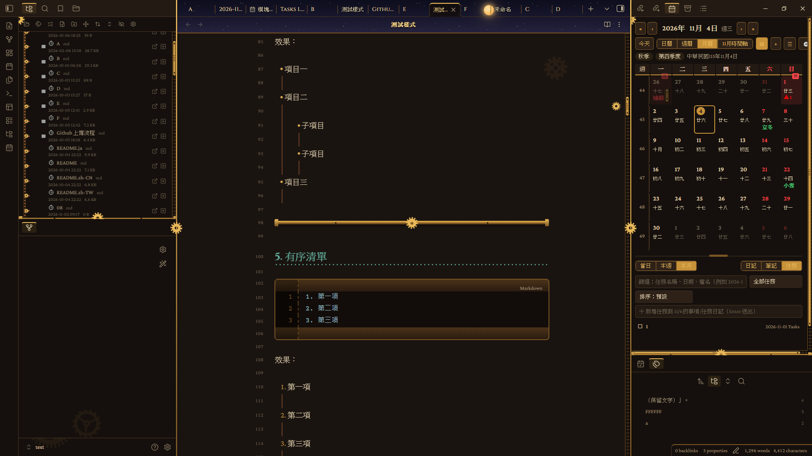
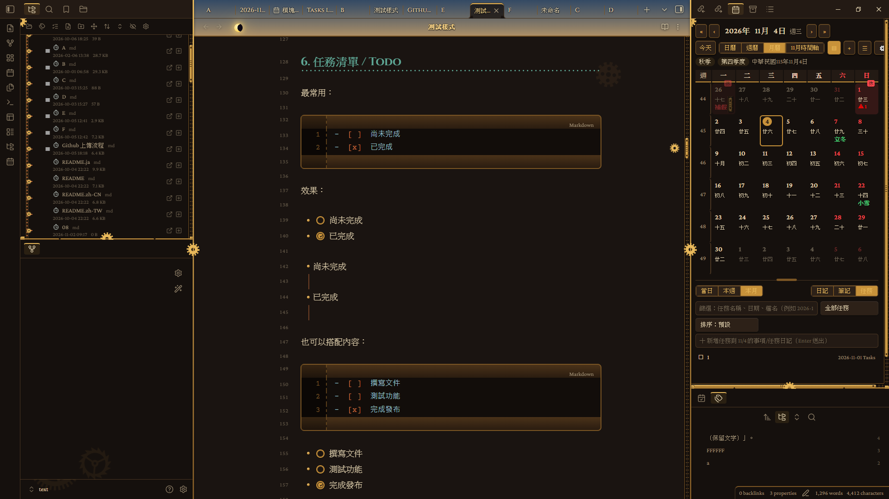
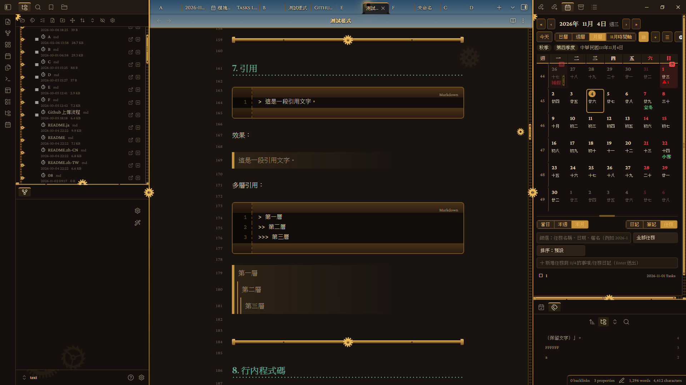
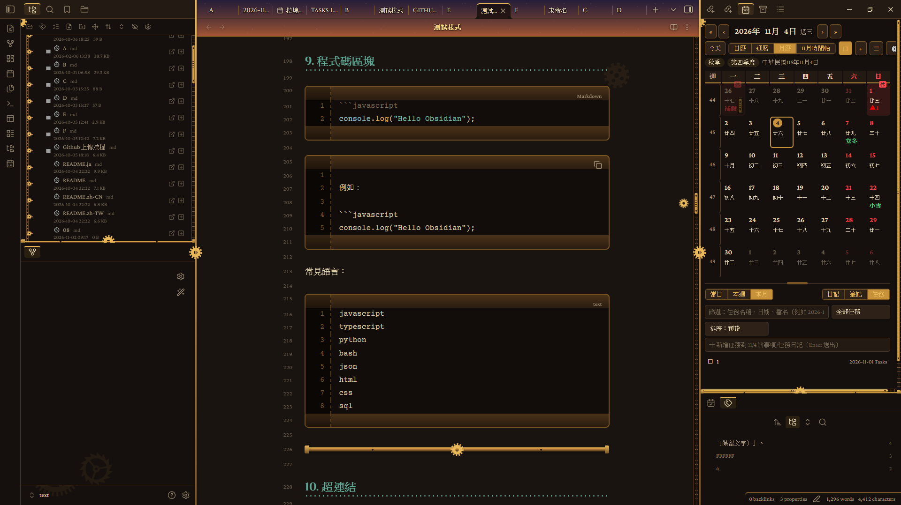
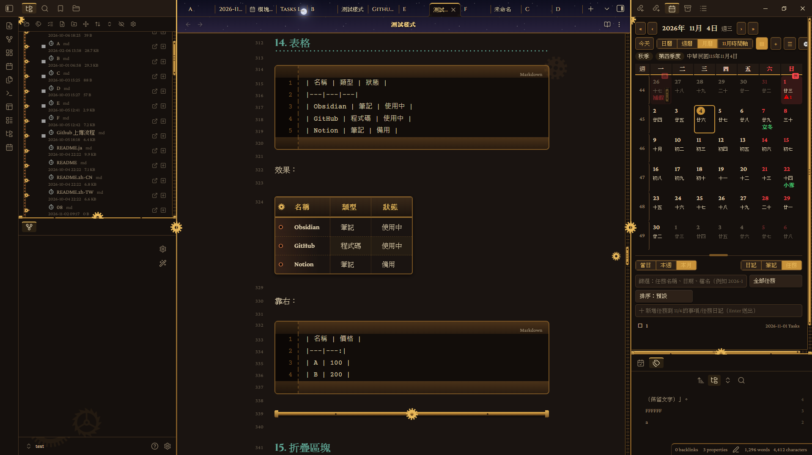
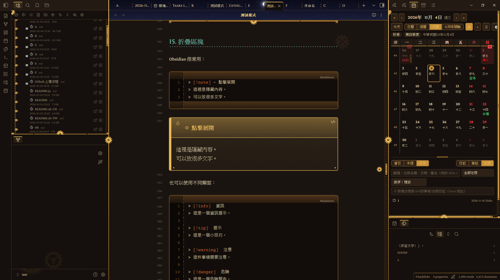

## Changelog

### 1.0.0

First release: dark and light color schemes, file explorer and editor styling, mechanical decorations, day-and-night sky, performance presets and Style Settings options.

## Features

### Colors and fonts
- Two color schemes: a dark "boiler room" and a light "parchment blueprint".
- Bright brass (H1, emphasis, bold), brass (borders, table headers, buttons), copper (H2, folder names) and verdigris (H3, links) are all customizable.
- Heading, body and code fonts are customizable (enter a full font list, separated by commas).

### Editor and content
- Heading levels, lists and indent lines, quotes, horizontal rules.
- **Callouts → gauge plates.**
- **Tables → punched-tape ledgers.**
- **Code blocks → control panels** with indicator lights on top and a line-number gutter on the left.
- **Task lists → mechanical dial checkboxes.**
- Tabs, sidebar frames and scrollbars.
- Layout adjustments for phones and tablets.

### File explorer
- Indent guides become **railway chains**: double rails with crossbeams, a small gear at every item that spins on hover.
- Collapse arrows become **gear arrows** that rotate 90° and light up when expanded.
- Folder icons become **riveted copper boxes**. File icons depend on the file type: notes are **mechanical dials**, canvas a compass, pdf / base a punch card, images a lens, **HTML angle brackets, audio a musical note, video a projector frame, code curly braces, archives a wooden crate, text and Office documents a sheet of paper, spreadsheets a grid**.

### Machinery and texture
- **Background gear sets**: a large and a small meshing gear at the top right of the editor, and a gear at the bottom of each sidebar. Opacity is adjustable.
- **Scroll-linked gear**: while you scroll or drag the scrollbar, a gear travels and spins along the right-hand rail.
- **File name plate**: the large title in the editor becomes a brass nameplate (turn on "Show inline title" in Settings → Editor → Appearance).
- **Parchment** background, **steam haze** (adjustable opacity), **riveted frame**, **metallic shine**.
- **Brass buttons / tags / search boxes**; links and selection colors use Obsidian variables, so they work in both light and dark.

### Day-and-night sky
- The tab bar (optionally extended to the breadcrumb bar) shows a day-night cycle: the sun, moon and stars move over time.
- Daytime features a normal, pale, amber and blood-red sun, plus a partial and a total solar eclipse.
- Nighttime features moon phases and a supermoon, three nebula nights, green and purple auroras, a meteor shower, a comet, a partial lunar eclipse and a blood moon, plus four wonders: solar system, galaxy, black hole and star cluster.
- The schedule is a pre-baked 72-day program built into the theme; no plugin is needed.
- You can adjust the length of one day-night cycle and how much the sky is dimmed (raise it if tab text is hard to read).

### Motion and performance
- **Background motion** is the master switch: when it is off, gears, steam, metallic shine and the sky all stay still.
- **Performance preset**: High quality (everything on), Balanced (celestial bodies at 30 fps; steam, metallic shine and the scroll-linked gear off), Power saving (also turns off full-window particles; celestial bodies drop to 10 fps).
- Celestial body (sun / moon) frame rate: 60 / 30 / 15 / 10 / 5 fps. Effect update rate (meteors, lightning, wonders): high / medium / low.

### Languages
- The option names in Style Settings automatically follow Obsidian's language: English, Traditional Chinese, Simplified Chinese or Japanese. If Obsidian uses any other language, English is shown.
- To change the language, change it in Obsidian under Settings → General → Language (a theme cannot switch it on its own).

### Content width
- By default, Obsidian's own content width is used.
- Your custom width is applied only after you turn on "Custom content width".

## How to use

### Getting started
1. Install the **Style Settings** plugin (recommended; all options live there).
2. Go to Settings → Appearance → Themes and choose **Steampunk Foundry**.
3. Open Style Settings → "Steampunk Foundry" and turn on the effects you want.

### To see the day-and-night sky
1. Turn on "Background motion".
2. Turn on "Day-and-night sky on the tab bar and breadcrumb bar".
3. To stretch the sky to the breadcrumb bar, also turn on "Extend sky to the breadcrumb bar".

### If it feels slow, or tab text is hard to read
- Large notes or low-end computers: set "Performance preset" to Balanced or Power saving.
- Tab text covered by the sky: raise "Sky dimming".

### If the options appear in the wrong language
- Style Settings follows Obsidian's own language (Settings → General → Language). Other languages fall back to English.

### If you use another icon plugin
- Keep "Folder and file icons" off to avoid duplicated icons.

## Installation

**Manual:** download `theme.css` and `manifest.json` from the latest [release](../../releases), put them into `<vault>/.obsidian/themes/Steampunk Foundry/`, then choose the theme in Settings → Appearance. Installing the **Style Settings** plugin as well is recommended.

## Notes

- **No network requests, no telemetry, free.**
- The day-and-night sky and animated backgrounds are drawn continuously. For large notes or low-end computers, set the performance preset to Balanced or Power saving.
- The file name plate requires "Show inline title" in Settings → Editor → Appearance.
- Mobile support is still experimental.

## Issues and suggestions

If you run into a problem or have a suggestion, please [open an issue](https://github.com/your-name/steampunk-foundry/issues) on GitHub. Including your Obsidian version, your theme settings and steps to reproduce (or a screenshot) makes it much easier to help.
