# Steampunk Foundry｜蒸汽朋克锅炉房

[English](README.md) | [繁體中文](README.zh-TW.md) | **简体中文** | [日本語](README.ja.md)

Obsidian 的蒸汽朋克主题：黄铜、红铜、铜绿的配色，铁轨缩进线、机械齿轮、仪表铭牌式的提示框，以及标签栏上日夜流转的日月星空。所有效果都**默认关闭**，需要什么就自己开什么。

日月星空预览图：
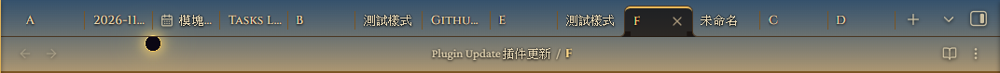
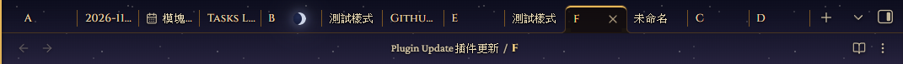
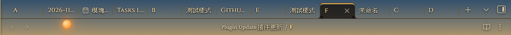
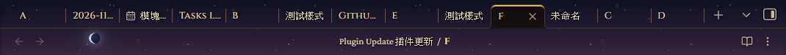
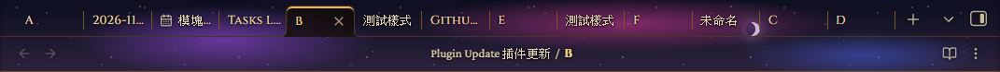
整体预览图：
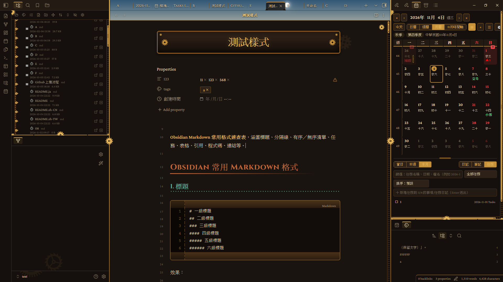
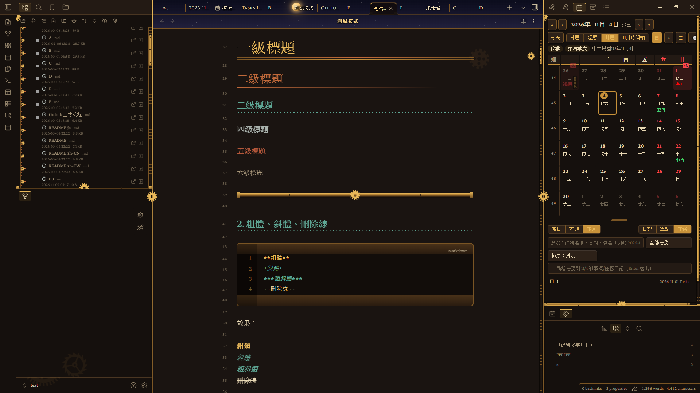
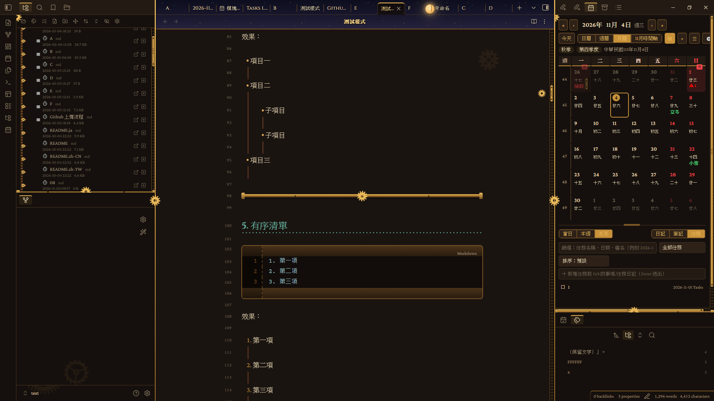
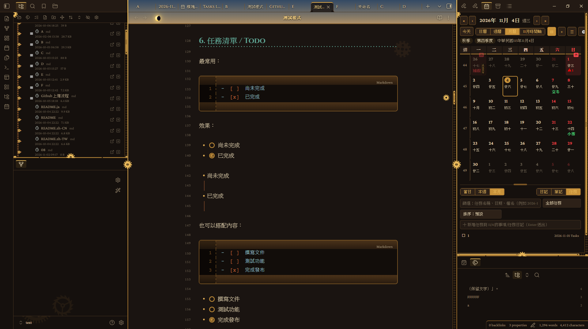
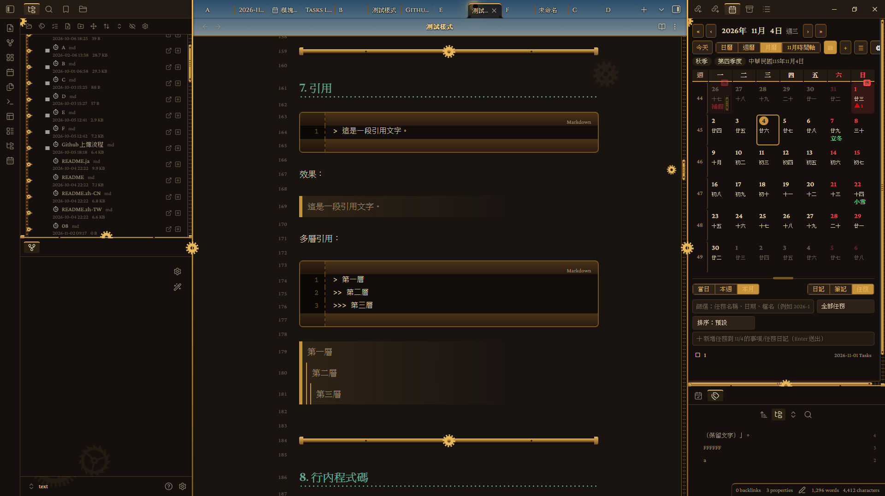
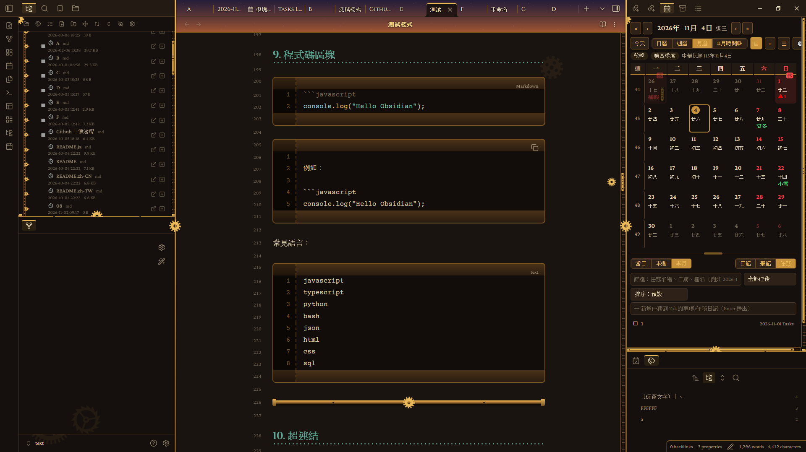
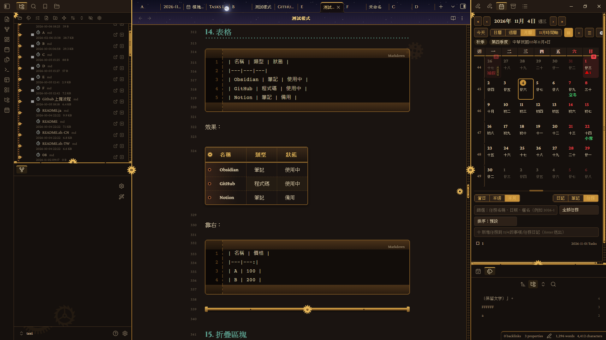
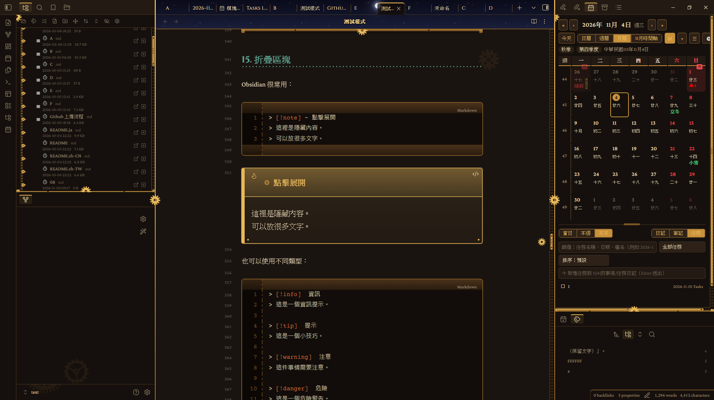
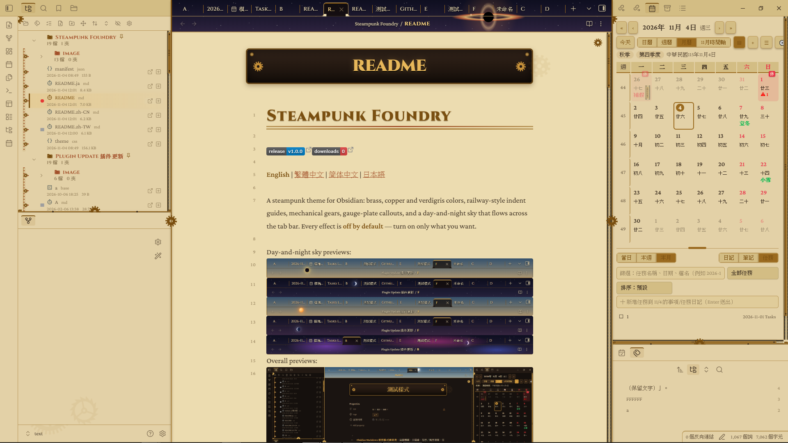

## 历史更新

### 1.0.0

首次发布：深色／浅色配色、文件浏览器与编辑器外观、机械装饰、日月星空、性能预设与 Style Settings 选项。

## 功能

### 配色与字体
- 深色「锅炉房」与浅色「羊皮蓝图」两种配色。
- 亮黄铜（H1、强调、粗体）、黄铜（边框、表头、按钮）、红铜（H2、文件夹名称）、铜绿（H3、链接）都能自定义颜色。
- 标题、正文、代码三种字体都能自定义（填完整字体列表，用逗号分隔）。

### 编辑器与内容
- 标题层级、列表与缩进线、引用、分隔线。
- **提示框（Callout）→ 仪表铭牌**。
- **表格 → 打孔纸带账本**。
- **代码块 → 控制台面板**：顶部指示灯与左侧行号槽。
- **任务列表 → 机械表面复选框**。
- 标签页、侧栏外框与滚动条。
- 手机／平板版面适配。

### 文件浏览器
- 缩进线变成**铁轨链条**：双轨加横梁，每个项目接一颗小齿轮，鼠标滑过会转动。
- 展开符号变成**齿轮箭头**，展开时旋转 90° 并亮起。
- 文件夹图标变成**铆接铜盒**；文件图标按类型区分：笔记是**机械表盘**，canvas 是罗盘，pdf／base 是打孔卡，图片是镜头，**HTML 是尖括号，音乐是音符，视频是放映框，代码是大括号，压缩包是木箱，文本与 Office 文档是纸页，表格是格线**。

### 机械与质感
- **背景齿轮群**：编辑区右上是一大一小啮合的齿轮，两侧栏底部各有齿轮，浓度可调。
- **滚动联动齿轮**：滚动或拖动滚动条时，齿轮沿着右侧轨道移动并转动。
- **文件名铭牌**：编辑器内的大标题变成黄铜铭牌（需在「设置 → 编辑器 → 外观」开启「显示内嵌标题」）。
- **羊皮纸质感**背景、**蒸汽雾气**（浓度可调）、**铆钉外框**、**金属闪光**。
- **黄铜按钮／标签／搜索框**，链接与选中色改用 Obsidian 变量，深浅色都适用。

### 日月星空
- 标签栏（可选择延伸到路径栏）会呈现日夜循环：太阳、月亮与星空随时间移动。
- 白天有一般、苍白、琥珀、血红的太阳，以及日偏食、日全食。
- 夜晚有各种月相与超级月亮、三种星云夜、绿色与紫色极光、流星雨、彗星、月偏食与血月，另有太阳系、银河系、黑洞、星团四种奇观。
- 节目表是主题内置预先排好的 72 天，不需要任何插件。
- 日夜循环一天的长度与天空压暗程度（标签文字看不清楚时调高）都能调整。

### 动态与性能
- **背景动态**是总开关：没开时，齿轮、蒸汽、金属闪光与天空都是静止的。
- **性能预设**：高画质（全开）、平衡（天体 30fps，关闭蒸汽、金属闪光与滚动联动齿轮）、省电（再关闭整窗粒子，天体降为 10fps）。
- 天体（太阳／月亮）帧率可选 60／30／15／10／5 fps；流星、闪电、奇观的更新率可选高／中／低。

### 多语言
- Style Settings 里的选项名称会自动跟随 Obsidian 的语言：English、繁体中文、简体中文、日本語；Obsidian 使用其他语言时显示 English。
- 想更改语言，请到 Obsidian「设置 → 通用 → 语言」（主题本身无法单独切换）。

### 内容栏宽
- 默认使用 Obsidian 原本的栏宽。
- 开启「自定义内容栏宽度」后，才会应用你设置的宽度。

## 使用说明

### 开始使用
1. 安装 **Style Settings** 插件（建议，所有选项都在那里）。
2. 设置 → 外观 → 主题，选择 **Steampunk Foundry**。
3. 到 Style Settings →「Steampunk Foundry」，开启你想要的效果。

### 看到日月星空
1. 开启「开启背景动态」。
2. 开启「开启标签栏与路径栏的日月星空」。
3. 想让天空延伸到路径栏，再开「天空延伸到路径栏」。

### 觉得变慢或标签文字看不清楚
- 大型笔记或低端电脑：把「性能预设」改成「平衡」或「省电」。
- 标签文字被天空盖住：调高「天空压暗程度」。

### 选项显示的语言不对
- Style Settings 跟随 Obsidian 自己的语言（设置 → 通用 → 语言）；其他语言会显示 English。

### 使用其他图标插件时
- 保持「开启文件夹与文件图标」关闭，避免和其他图标重复。

## 安装

**手动：** 从最新的 [release](../../releases) 下载 `theme.css` 与 `manifest.json`，放进 `<库>/.obsidian/themes/Steampunk Foundry/`，再到「设置 → 外观」选择主题。建议另外安装 **Style Settings** 插件。

## 声明

- **没有任何网络请求、没有遥测、不收费。**
- 日月星空、动态背景会持续绘制；大型笔记或低端电脑建议把「性能预设」调成「平衡」或「省电」。
- 文件名铭牌需要在「设置 → 编辑器 → 外观」开启「显示内嵌标题」。
- 手机版仍属实验性质。

## 问题反馈与建议

如果遇到问题或有任何建议，欢迎到 GitHub 项目中[提交 Issues](https://github.com/your-name/steampunk-foundry/issues)。反馈时若能附上 Obsidian 版本、使用的主题设置与复现步骤（或截图），会更容易处理。
