# Steampunk Foundry｜蒸氣朋克鍋爐房

[English](README.md) | **繁體中文** | [簡體中文](README.zh-CN.md) | [日本語](README.ja.md)

Obsidian 的蒸氣朋克佈景主題：黃銅、紅銅、銅綠的配色，鐵軌縮排線、機械齒輪、儀表銘牌式的提示框，以及分頁列上日夜流轉的日月星空。所有效果都**預設關閉**，需要什麼就自己開什麼。

日月星空預覽圖：
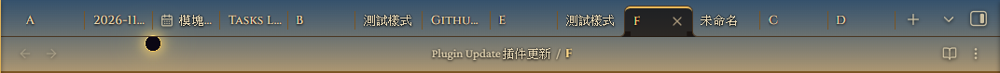
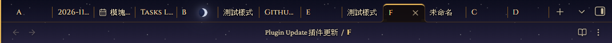
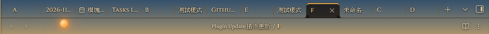
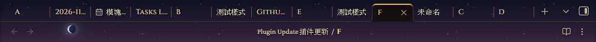
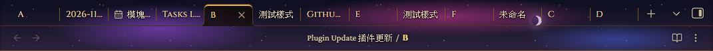
整體預覽圖：
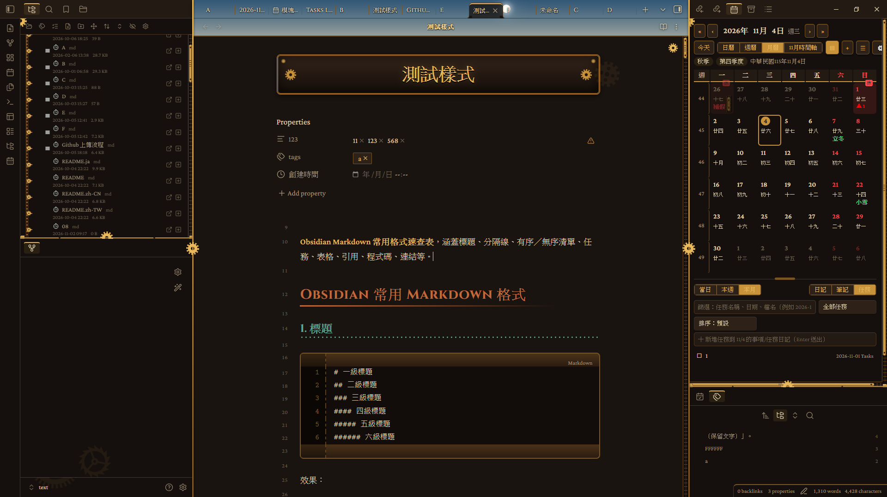
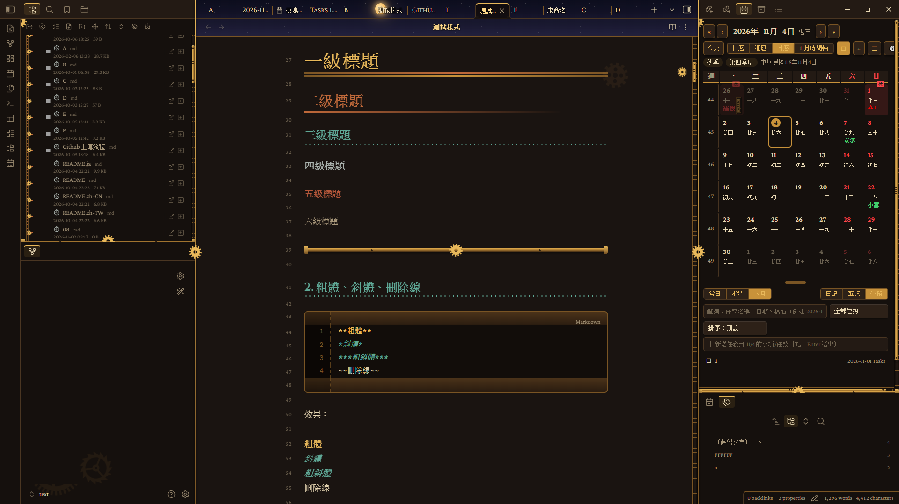
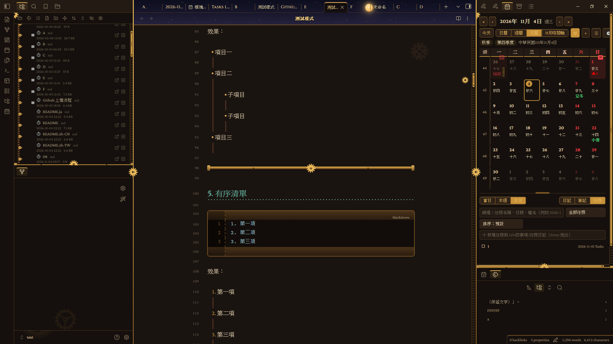
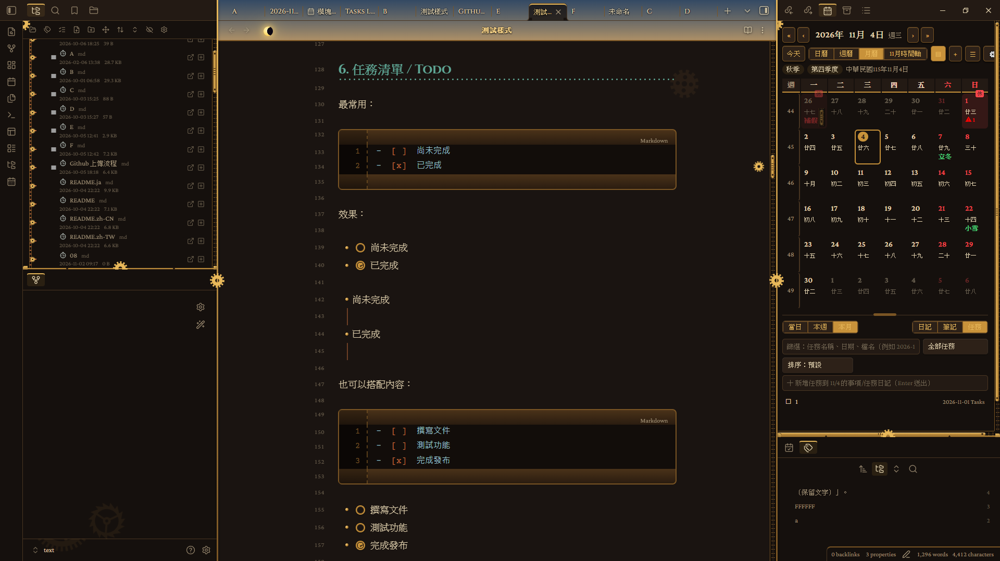
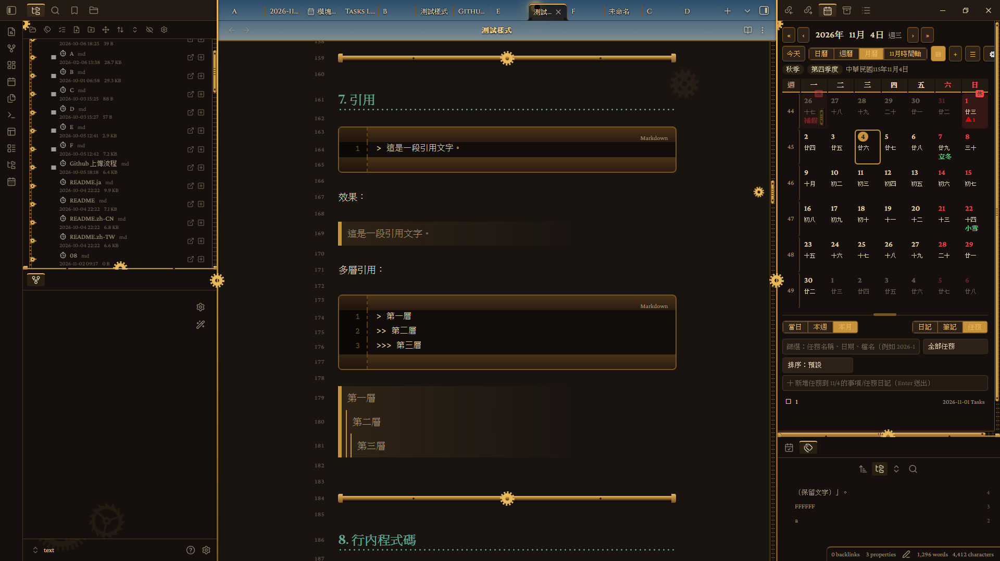
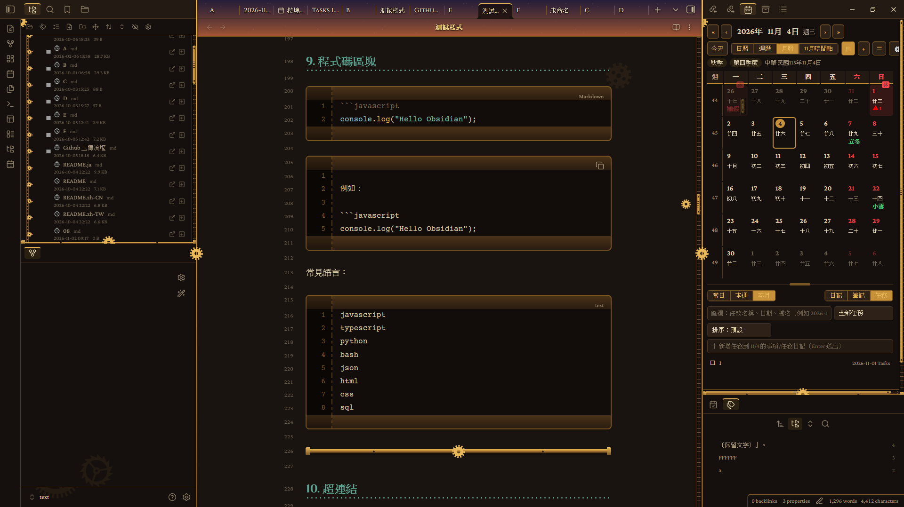
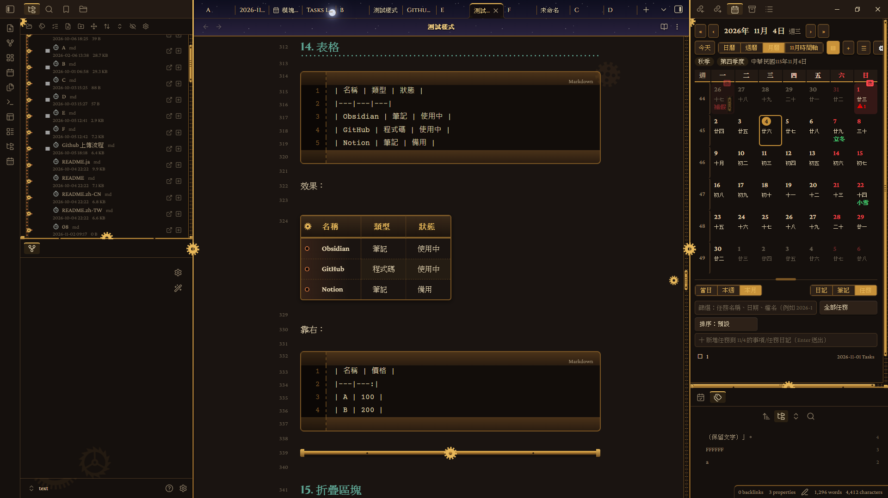
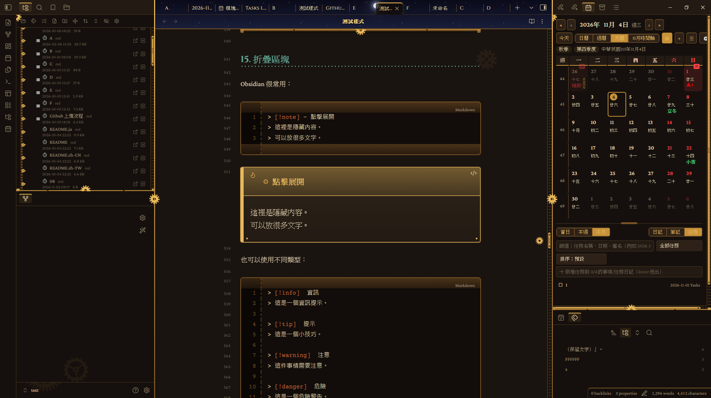
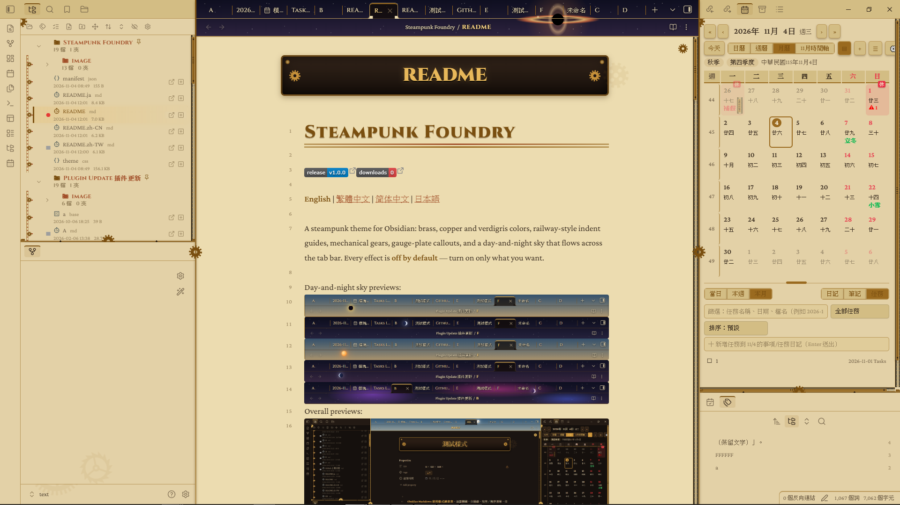

## 歷史更新

### 1.0.0

首次發布：深色／淺色配色、檔案瀏覽器與編輯器外觀、機械裝飾、日月星空、效能預設與 Style Settings 選項。

## 功能

### 配色與字體
- 深色「鍋爐房」與淺色「羊皮藍圖」兩種配色。
- 亮黃銅（H1、強調、粗體）、黃銅（邊框、表頭、按鈕）、紅銅（H2、文件夾名稱）、銅綠（H3、連結）都能自訂顏色。
- 標題、正文、代碼三種字體都能自訂（填完整字體清單，用逗號分隔）。

### 編輯器與內容
- 標題層級、列表與縮排線、引用、分隔線。
- **提示框（Callout）→ 儀表銘牌**。
- **表格 → 打孔紙帶帳本**。
- **代碼塊 → 控制台面板**：頂部指示燈與左側行號槽。
- **任務清單 → 機械錶面複選框**。
- 分頁、側欄外框與捲軸。
- 手機／平板版面適配。

### 檔案瀏覽器
- 縮排線變成**鐵軌鏈條**：雙軌加橫梁，每個項目接一顆小齒輪，滑過會轉動。
- 展開符號變成**齒輪箭頭**，展開時轉 90° 並亮起。
- 文件夾圖示變成**鉚接銅盒**；文件圖示依類型區分：筆記是**機械錶盤**，canvas 是羅盤，pdf／base 是打孔卡，圖片是鏡頭，**HTML 是尖括號，音樂是音符，影片是放映框，程式碼是大括號，壓縮檔是木箱，文字與 Office 文件是紙頁，試算表是格線**。

### 機械與質感
- **背景齒輪群**：編輯區右上是一大一小咬合的齒輪，兩側欄底部各有齒輪，濃度可調。
- **捲動連動齒輪**：捲動或拖動滾動條時，齒輪沿著右側軌道移動並轉動。
- **檔名銘牌**：編輯器內的大標題變成黃銅銘牌（需在「設定 → 編輯器 → 外觀」開啟「顯示內嵌標題」）。
- **羊皮紙質感**背景、**蒸氣霧氣**（濃度可調）、**鉚釘外框**、**金屬閃光**。
- **黃銅按鈕／標籤／搜尋框**，連結與選取色改用 Obsidian 變數，深淺色都適用。

### 日月星空
- 分頁列（可選擇延伸到路徑列）會呈現日夜循環：太陽、月亮與星空隨時間移動。
- 白天有一般、蒼白、琥珀、血紅的太陽，以及日偏食、日全食。
- 夜晚有各種月相與超級月亮、三種星雲夜、綠色與紫色極光、流星雨、彗星、月偏食與血月，另有太陽系、銀河系、黑洞、星團四種奇觀。
- 節目表是主題內建預先排好的 72 天，不需要任何插件。
- 日夜循環一天的長度與天空壓暗程度（分頁文字看不清楚時調高）都能調整。

### 動態與效能
- **背景動態**是總開關：沒開時，齒輪、蒸汽、金屬閃光與天空都是靜止的。
- **效能預設**：高畫質（全開）、平衡（天體 30fps，關閉蒸氣、金屬閃光與捲動連動齒輪）、省電（再關閉整窗粒子，天體降為 10fps）。
- 天體（太陽／月亮）幀率可選 60／30／15／10／5 fps；流星、閃電、奇觀的更新率可選高／中／低。

### 多國語言
- Style Settings 裡的選項名稱會自動跟隨 Obsidian 的語言：English、繁體中文、簡體中文、日本語；Obsidian 使用其他語言時顯示 English。
- 想更改語言，請到 Obsidian「設定 → 一般 → 語言」（主題本身無法單獨切換）。

### 內容欄寬
- 預設使用 Obsidian 原本的欄寬。
- 開啟「自訂內容欄寬度」後，才會套用你設定的寬度。

## 操作說明

### 開始使用
1. 安裝 **Style Settings** 插件（建議，所有選項都在那裡）。
2. 設定 → 外觀 → 主題，選擇 **Steampunk Foundry**。
3. 到 Style Settings →「Steampunk Foundry」，開啟你想要的效果。

### 看到日月星空
1. 開啟「開啟背景動態」。
2. 開啟「開啟分頁列與路徑列的日月星空」。
3. 想讓天空延伸到路徑列，再開「天空延伸到路徑列」。

### 覺得變慢或分頁文字看不清楚
- 大型筆記或低階電腦：把「效能預設」改成「平衡」或「省電」。
- 分頁文字被天空蓋住：調高「天空壓暗程度」。

### 選項顯示的語言不對
- Style Settings 跟隨 Obsidian 自己的語言（設定 → 一般 → 語言）；其他語言會顯示 English。

### 使用其他圖標插件時
- 保持「開啟文件夾與文件圖標」關閉，避免和其他圖標重複。

## 安裝

**手動：** 從最新的 [release](../../releases) 下載 `theme.css` 與 `manifest.json`，放進 `<庫>/.obsidian/themes/Steampunk Foundry/`，再到「設定 → 外觀」選擇主題。建議另外安裝 **Style Settings** 插件。

## 聲明

- **沒有任何網路請求、沒有遙測、不收費。**
- 日月星空、動態背景會持續繪製；大型筆記或低階電腦建議把「效能預設」調成「平衡」或「省電」。
- 檔名銘牌需要在「設定 → 編輯器 → 外觀」開啟「顯示內嵌標題」。
- 手機版仍屬實驗性質。

## 問題回報與建議

如果遇到問題或有任何建議，歡迎到 GitHub 專案中[提交 Issues](https://github.com/your-name/steampunk-foundry/issues)。回報時若能附上 Obsidian 版本、使用的主題設定與重現步驟（或截圖），會更容易處理。
